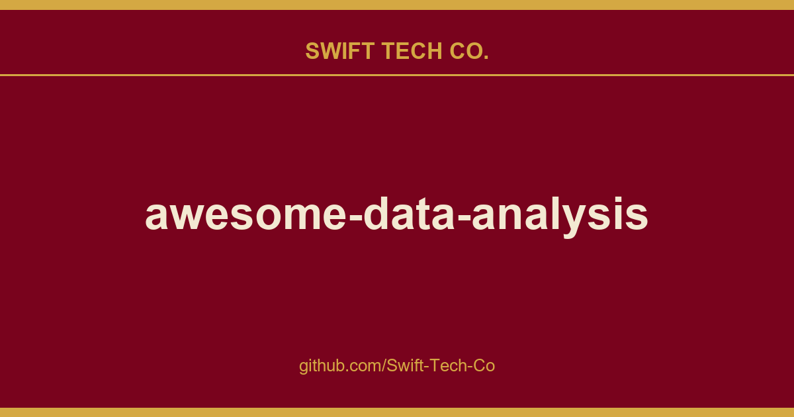

# awesome-data-analysis

## What This Is

A practical reference entry for product and engineering: the awesome-data-analysis notes, examples and fixes we reach for repeatedly. Kept current as part of the wider Swift Tech Co. engineering library.

## Images

## 📑 Contents

- [🏆 Awesome Data Science Repositories](#awesome-data-science-repositories)
- [🗺️ Roadmaps](#roadmaps)
- [🐍 Python](#python)
  - [Resources](#python-resources)
  - [Data Manipulation with Pandas and Numpy](#python-data-manipulation-with-pandas-and-numpy)
  - [Useful Python Tools for Data Analysis](#python-useful-python-tools-for-data-analysis)
    - [Data Processing \& Transformation](#python-data-processing-transformation)
    - [Automated EDA and Visualization Tools](#python-automated-data-visualization-tools)
    - [Data Quality \& Validation](#python-data-quality-validation)
    - [Feature Engineering & Selection](#python-feature-engineering-selection)
    - [Specialized Data Tools](#python-specialized-data-tools)
- [🗃️ SQL \& Databases](#sql-databases)
  - [Resources](#sql-databases-resources)
  - [Databases](#sql-databases-engines)
  - [Tools](#sql-databases-tools)
- [📊 Data Visualization](#data-visualization)
  - [Resources](#data-visualization-resources)
  - [Tools](#data-visualization-tools)
- [📈 Dashboards & BI](#dashboards)
  - [Resources](#dashboards-resources)
  - [Tools](#dashboards-tools)
  - [Software](#dashboards-software)
- [🕸️ Web Scraping \& Crawling](#web-scraping-crawling)
  - [Resources](#web-scraping-crawling-resources)
  - [Tools](#web-scraping-crawling-tools)
- [🔢 Mathematics](#mathematics)
- [🎲 Statistics \& Probability](#statistics-probability)
  - [Resources](#statistics-probability-resources)
  - [Tools](#statistics-probability-tools)
- [🧪 A/B Testing](#ab-testing)
- [⏳ Time Series Analysis](#time-series-analysis)
  - [Resources](#time-series-analysis-resources)
  - [Tools](#time-series-analysis-tools)
- [⚙️ Data Engineering](#data-engineering)
  - [Resources](#data-engineering-resources)
  - [Tools](#data-engineering-tools)
- [📖 Natural Language Processing (NLP)](#natural-language-processing-nlp)
  - [Resources](#natural-language-processing-nlp-resources)
  - [Tools](#natural-language-processing-nlp-tools)
- [🤖 Machine Learning & AI](#machine-learning)
  - [Resources](#machine-learning-resources)
  - [Tools](#machine-learning-tools)
- [🚀 MLOps](#mlops)
  - [Resources](#mlops-resources)
  - [Tools](#mlops-tools)
- [🧠 AI Applications & Platforms](#ai-applications)
  - [Resources](#ai-applications-resources)
  - [Tools](#ai-applications-tools)
- [☁️ Cloud Platforms & Infrastructure](#cloud-platforms)
  - [Resources](#cloud-platform-resources)
  - [Tools](#cloud-platform-tools)
- [🏗️ System Design & Architecture](#system-design)
- [⚡ Productivity](#productivity)
  - [Resources](#productivity-resources)
  - [Useful Linux Tools](#productivity-useful-linux-tools)
  - [Useful VS Code Extensions](#productivity-useful-vs-code-extensions)
- [📚 Skill Development \& Career](#skill-development-career-resources)
  - [Practice Resources](#skill-development-career-resources-practice-resources)
  - [Curated Jupyter Notebooks](#skill-development-career-resources-curated-jupyter-notebooks)
  - [Data Sources \& Datasets](#skill-development-career-resources-data-sources-datasets)
  - [Resume and Interview Tips](#skill-development-career-resources-resume-and-interview-tips)
- [📋 Cheatsheets](#cheatsheets)
  - [GoalKicker Programming Notes](#cheatsheets-goalkicker)
  - [Python](#cheatsheets-python)
  - [Data Science \& Machine Learning](#cheatsheets-data-science-machine-learning)
  - [Linux \& Git](#cheatsheets-linux-git)
  - [Probability \& Statistics](#cheatsheets-probability-statistics)
  - [SQL \& Databases](#cheatsheets-sql-databases)
  - [Miscellaneous](#cheatsheets-miscellaneous)
- [📦 Additional Python Libraries](#additional-python-libraries)
- [📝 More Awesome Lists](#more-awesome-curations)
- [🌐 Additional Resources and Tools](#additional-resources)
- [🤝 Contributing](#contributing)
- [📜 License](#license)

---

## 🏆 Awesome Data Science Repositories

Curated collections of high-quality GitHub repos for inspiration and learning.

- Awesome Data Science - A curated list of courses, books, tools, and resources for data science.
- Data Science for Beginners - Microsoft's data science curriculum.  
- OSSU Data Science - Open Source Society University's self-study path.  
- Data Science Best Resources - Carefully curated links for data science resources in one place.
- Data Science Articles from CodeCut - A collection of articles, videos, and code related to data science.
- Data Science Using Python - Resources for data analysis using Python.

[⬆ back to contents](#contents)

---

## 🗺️ Roadmaps

Step-by-step guides and skill trees to master data science and analytics.

- Data Analyst Roadmap - Structured learning path for analysts.
- Data Science Roadmap from A to Z - Comprehensive roadmap for data science.
- Roadmap To Learn Data Science - A comprehensive and updated roadmap for learning data science with modern tools and technologies.
- 66DaysOfData - 66-day data analytics learning challenge.
- Data Analyst Roadmap for Professionals - 8-week program for analysts at all levels.
- Data Science Roadmap Tutorials - Tutorials for the data science roadmap.
- Data Analyst Roadmap from Zero - Guide to becoming a data analyst from scratch.

[⬆ back to contents](#contents)

---

## 🐍 Python

### Resources

A collection of resources for learning and mastering Python programming.

- Awesome Python - An opinionated list of awesome Python frameworks, libraries, software, and resources.
- 30 Days Of Python - A 30-day programming challenge to learn the Python programming language.
- Real Python Tutorials - Tutorials on Python from Real Python.
- Awesome Python Data Science - A curated list of Python resources for data science.
- Python Data Science Handbook - Full text of the "Python Data Science Handbook" in Jupyter Notebooks.
- Interactive Coding Challenges - 120+ interactive Python coding interview challenges.
- Clean Code Python - Clean Code concepts adapted for Python.
- Best of Python - A ranked list of awesome Python open-source libraries and tools.
- GeeksforGeeks Python - Python tutorial from GeeksforGeeks.
- W3Schools Python - A beginner-friendly tutorial and reference for the Python programming language.
- Tanu N Prabhu Python - This repository helps you understand Python from scratch.
- Think Python - Jupyter notebooks and other resources for Think Python by Allen Downey.

[⬆ back to contents](#contents)

---

### Data Manipulation with Pandas and Numpy

Tutorials and best practices for working with Pandas and Numpy.

- Awesome Pandas - A curated list of resources for using the Pandas library.
- 100 data puzzles for pandas - A collection of data puzzles to practice your Pandas skills.
- Pandas Tutor - Visualize Pandas operations step-by-step (perfect for beginners).
- Pandas Exercises - Exercises designed to help you improve your Pandas skills.
- Pandas Cookbook - A cookbook with various recipes for using Pandas effectively.
- Hands-On Data Analysis with Pandas - Materials for following along with Hands-On Data Analysis with Pandas.
- Effective Pandas - A series focused on writing effective and idiomatic Pandas code.
- From Python to Numpy - An open-access book on vectorization and efficient numerical computing with NumPy.
- NumPy 100 Exercises - A collection of 100 exercises to master the NumPy library for scientific computing.

[⬆ back to contents](#contents)

---

### Useful Python Tools for Data Analysis

A collection of Python libraries for efficient data manipulation, cleaning, visualization, validation, and analysis.

#### Data Processing & Transformation

- Pandas - Powerful Python library for data analysis and manipulation with flexible data structures.
- NumPy - Fundamental package for scientific computing in Python with multidimensional array support.
- Pandas DQ - Data type correction and automatic DataFrame cleaning.
- Vaex - High-performance Python library for lazy Out-of-Core DataFrames.
- Polars - Multithreaded, vectorized query engine for DataFrames.
- Fugue - Unified interface for Pandas, Spark, and Dask.
- TheFuzz - Fuzzy string matching (Levenshtein distance).
- DateUtil - Extensions for standard Python datetime features.
- Arrow - Enhanced work with dates and times.
- Pendulum - Alternative to datetime with timezone support.
- Dask - Parallel computing for arrays and DataFrames.
- Modin - Speeds up Pandas by distributing computations.
- Pandarallel - Parallel operations for pandas DataFrames.
- DataCleaner - Python tool for automatically cleaning and preparing datasets.
- Pandas Flavor - Add custom methods to Pandas.
- Pandas DataReader - Reads data from various online sources into pandas DataFrames.
- Sklearn Pandas - Bridge between Pandas and Scikit-learn.
- CuPy - A NumPy-compatible array library accelerated by NVIDIA CUDA for high-performance computing.
- Numba - A JIT compiler that translates a subset of Python and NumPy code into fast machine code.
- Pandas Stubs - Type stubs for pandas, improves IDE autocompletion.
- Petl - ETL tool for data cleaning and transformation.

[⬆ back to contents](#contents)

---

#### Automated EDA and Visualization Tools

- AutoViz - Automatic data visualization in 1 line of code.
- Sweetviz - Automatic EDA with dataset comparison.
- Lux - Automatic DataFrame visualization in Jupyter.
- YData Profiling - Data quality profiling & exploratory data analysis.
- Missingno - Visualize missing data patterns.
- Vizro - Low-code toolkit for building data visualization apps.
- Yellowbrick - Visual diagnostic tools for machine learning.
- Great Tables - Create awesome display tables using Python.
- DataMapPlot - Create beautiful plots of data maps.
- Datashader - Quickly and accurately render even the largest data.
- PandasAI - Conversational data analysis using LLMs and RAG.
- Mito - Jupyter extensions for faster code writing.
- D-Tale - Interactive GUI for data analysis in a browser.
- Pandasgui - GUI for viewing and filtering DataFrames.
- PyGWalker - Interactive UIs for visual analysis of DataFrames.
- QGrid - Interactive grid for DataFrames in Jupyter.
- Pivottablejs - Interactive PivotTable.js tables in Jupyter.

[⬆ back to contents](#contents)

---

#### Data Quality & Validation

- PyOD - Outlier and anomaly detection.
- Alibi Detect - Outlier, adversarial and drift detection.
- Pandera - Data validation through declarative schemas.
- Cerberus - Data validation through schemas.
- Pydantic - Data validation using Python type annotations.
- Dora - Automate EDA: preprocessing, feature engineering, visualization.
- Great Expectations - Data validation and testing.

[⬆ back to contents](#contents)

---

#### Feature Engineering & Selection

- FeatureTools - Automated feature engineering.
- Feature Engine - Feature engineering with Scikit-Learn compatibility.
- Prince - Multivariate exploratory data analysis (PCA, CA, MCA).
- Fitter - Figures out the distribution your data comes from.
- Feature Selector - Tool for dimensionality reduction of machine learning datasets.
- Category Encoders - Extensive collection of categorical variable encoders.
- Imbalanced Learn - Handling imbalanced datasets.

[⬆ back to contents](#contents)

---

#### Specialized Data Tools

- cuDF - A GPU DataFrame library for loading, joining, and aggregating data.
- Faker - Generates fake data for testing.
- Mimesis - Generates realistic test data.
- Geopy - Geocoding addresses and calculating distances.
- PySAL - Spatial analysis functions.
- Scattertext - Beautiful visualizations of language differences among document types.
- IGraph - A library for creating and manipulating graphs and networks, with bindings for multiple languages.
- Joblib - A lightweight pipelining library for Python, particularly useful for saving and loading large NumPy arrays.
- ImageIO - A library that provides an easy interface to read and write a wide range of image data.
- Texthero - Text preprocessing, representation and visualization.
- Geopandas - Geographic data operations with pandas.
- NetworkX - Network analysis and graph theory.
- Chardet - Python library to detect the character encoding of text and files.

[⬆ back to contents](#contents)

---

## 🗃️ SQL & Databases

### Resources

SQL tutorials and database design principles.

- SQLZoo - SQL Tutorial - Interactive SQL tutorial.
- SQL Bolt - Learn SQL - Learn SQL through interactive lessons.
- SQL Tutorial - Comprehensive SQL tutorial resource.
- SQL Tutorial by W3Schools. - Comprehensive SQL tutorial.
- PostgreSQL Tutorial by W3Resource - Tutorial for PostgreSQL.
- MySQL Tutorial by W3Resource - Tutorial for MySQL.
- MongoDB Tutorial by W3Resource - Tutorial for MongoDB.
- EverSQL - AI-powered SQL query optimization and database observability tool.
- Awesome Database Learning - Educational resources on database internals, distributed systems, and storage.
- Awesome Postgres - A curated list of awesome PostgreSQL software, libraries, tools and resources.
- Awesome MySql - A curated list of awesome MySQL software, libraries, tools and resources.
- Awesome Clickhouse - A curated list of awesome ClickHouse software.
- Awesome MongoDB - A curated list of awesome MongoDB resources, libraries, tools, and applications.
- Awesome Duckdb - Curated tools, resources, and extensions for DuckDB analytical database.
- Awesome SQLAlchemy - A curated list of awesome tools for SQLAlchemy.
- Awesome Sql - List of tools and techniques for working with relational databases.
- AnimateSQL - Interactive tool that visualizes the step-by-step execution of SQL queries.
- SQL Tips and Tricks - Useful SQL techniques and optimizations for data analysis.
- Practice Window Functions - Free interactive SQL tutorial site focused on mastering window functions through 80+ hands-on problems with hints and solutions.

[⬆ back to contents](#contents)

---

### Databases

Popular open-source database systems for a variety of use cases and data models.

- SQLite  Embedded, file‑based SQL engine, the most used database in the world.
- PostgreSQL  Advanced open‑source relational database with extensibility and SQL compliance.
- MySQL  Widely used relational database management system (Oracle’s community version).
- MariaDB  Community developed fork of MySQL with enhanced features.
- DuckDB  In‑process analytical database designed for fast OLAP queries.
- ClickHouse  Columnar database for real‑time analytics on large datasets.
- Apache Cloudberry - A mature open-source MPP database evolved from Greenplum with a newer PostgreSQL kernel.
- TimescaleDB  Time‑series SQL database built on PostgreSQL.
- TDengine  Time‑series database for IoT, vehicles, and industrial monitoring.
- MongoDB  Document database with a flexible, JSON‑like data model.
- Cassandra  Highly scalable, distributed NoSQL database for large‑scale deployments.
- Redis  In‑memory data structure store used as database, cache, and message broker.
- CockroachDB  Distributed SQL database with strong consistency and horizontal scaling.
- Neo4j  Native graph database for connected data and relationships.
- InfluxDB  Purpose‑built time‑series database for metrics and events.
- ScyllaDB  Drop‑in Cassandra alternative written in C++ for higher performance.
- Apache HBase  Distributed, scalable, big data store modeled after Google's Bigtable, running on top of HDFS.

[⬆ back to contents](#contents)

---

### Tools

A collection of libraries and drivers for seamless database access and interaction.

- PyODBC - Python library for ODBC database access.
- SQLAlchemy - SQL toolkit and ORM for Python.
- Psycopg2 - PostgreSQL database adapter.
- MySQL Connector/Python - MySQL driver for Python.
- PonyORM - ORM for Python with dynamic query generation.
- PyMongo - Official MongoDB driver for Python.
- SQLiteviz - A tool for exploring SQLite databases and visualizing the results of your queries.
- DB Browser for SQLite - A high quality, visual, open source tool to create, design, and edit database files compatible with SQLite.
- DBeaver - A free universal database tool and SQL client for developers, SQL programmers, and administrators.
- Beekeeper Studio - A modern, easy-to-use SQL client and database manager with a clean, cross-platform interface.
- DBConvert Streams - Database IDE for exploring, migrating, and syncing PostgreSQL, MySQL, files, and S3.
- SQLFluff - A modular SQL linter and auto-formatter designed to enforce consistent style and catch errors in SQL code.
- PyMySQL - A pure-Python MySQL client library for interacting with MySQL databases from Python applications.
- Vanna.AI - An AI-powered tool for generating SQL queries from natural language questions.
- SQLChat - A chat-based SQL client that allows you to query databases using natural language conversations.
- Records - SQL queries to databases via Python syntax.
- Dataset - JSON-like interface for working with SQL databases.
- SQLGlot - A no-dependency SQL parser, transpiler, and optimizer for Python.

[⬆ back to contents](#contents)

---

## 📊 Data Visualization

### Resources

Color theory, chart selection guides, and storytelling tips.

- From Data to Viz - A guide to choosing the right visualization based on your data.
- Awesome DataViz - A curated list of awesome data visualization libraries, tools, and resources.
- Visualization Curriculum - Interactive notebooks designed to teach data visualization concepts.
- Scientific Visualization Book - Guide to creating effective scientific visualizations and plots.
- The Python Graph Gallery - A collection of Python graph examples for data visualization.
- FlowingData - Insights on data analysis and visualization.
- Data Visualization Catalogue - A comprehensive catalog of data visualization types.
- Data Viz Project - A resource for selecting suitable visualizations.
- Chartopedia - A guide to help you select the appropriate chart types.
- DataForVisualization - Tutorials and insights on data visualization techniques.
- Truth & Beauty - Exploration of the aesthetics of data visualization.
- Cedric Scherer's DataViz Resources - A collection of top data visualization resources and inspiration.
- Information is Beautiful - A site dedicated to visualizations that make complex ideas clear and engaging.
- Plottie - A vast library of scientific plots for visualization inspiration and ideas.
- Friends Don't Let Friends - A collection of bad data visualization practices and better alternatives.
- Natural Colours - A digital archive of historical color systems and pigments.
- Colorgorical - Resource for generating categorical color palettes using perceptual principles.

[⬆ back to contents](#contents)

---

### Tools

Libraries for static, interactive, and 3D visualizations.

- Matplotlib - A comprehensive library for creating static, animated, and interactive visualizations in Python.
- Seaborn - A statistical data visualization library based on Matplotlib.
- Plotly - A library for creating interactive plots and dashboards.
- Altair - A declarative statistical visualization library for Python.
- Bokeh - A library for creating interactive visualizations for modern web browsers.
- HoloViews - A tool for building complex visualizations easily.
- Geopandas - An extension of Pandas for geospatial data.
- Folium - A library for visualizing data on interactive maps.
- Pygal - A Python SVG charting library.
- Plotnine - A grammar of graphics for Python.
- Bqplot - A plotting library for IPython/Jupyter notebooks.
- PyPalettes - A large (+2500) collection of color maps for Python.
- Deck.gl - A WebGL-powered framework for visual exploratory data analysis of large datasets.
- Python for Geo - Contextily: add background basemaps to your plots in GeoPandas.
- OSMnx - A package to easily download, model, analyze, and visualize street networks from OpenStreetMap.
- Apache ECharts - A powerful, interactive charting and visualization library for browser-based applications.
- VisPy - A high-performance interactive 2D/3D data visualization library leveraging the power of OpenGL.
- Glumpy - A Python library for scientific visualization that is fast, scalable and beautiful, based on OpenGL.
- Pandas-bokeh - Bokeh plotting backend for Pandas.
- QGIS - Free, open source, cross-platform geographic information system (GIS).
- Flourish - Platform for creating interactive data visualizations and stories without coding.

[⬆ back to contents](#contents)

---

## 📈 Dashboards & BI

### Resources

Ttutorials for building and enhancing dashboards and visualizations using various tools and frameworks.

- Awesome Dashboards - A collection of outstanding dashboard and visualization resources.
- Best of Streamlit - Showcase of community-built Streamlit applications.
- Awesome Dash - Comprehensive resources for Dash users.
- Awesome Panel - Resources and support for Panel users.
- Awesome Streamlit - Curated list of Streamlit resources and components.
- Dash Enterprise Samples - Production-ready Dash apps.
- geeksforgeeks - Tableau Tutorial - Comprehensive tutorial on Tableau.
- geeksforgeeks - Power BI Tutorial - Detailed tutorial on Power BI.
- Tableau Public Gallery - A curated collection of real-world interactive dashboards to inspire and learn from.

[⬆ back to contents](#contents)

---

### Tools

Frameworks for building custom dashboard solutions.

- Dash - Framework for creating interactive web applications.
- Streamlit - Simplified framework for building data applications.
- Panel - Python library for creating custom interactive web apps and dashboards.
- Gradio - Tool for creating and sharing machine learning applications.
- OpenSearch Dashboards - A powerful data visualization and dashboarding tool for OpenSearch data, forked from Kibana.
- GridStack.js - A library for building draggable, resizable responsive dashboard layouts.
- Tremor - A React library to build dashboards fast with pre-built components for charts, KPIs, and more.
- Appsmith - An open-source platform to build and deploy internal tools, admin panels, and CRUD apps quickly.
- Grafanalib - A Python library for generating Grafana dashboards configuration as code.
- H2O Wave - A Python framework for rapidly building and deploying realtime web apps and dashboards for AI and analytics.
- Shiny for Python - Python version of the popular R Shiny framework.
- Voilà - Turn Jupyter notebooks into standalone web applications.
- Reflex - Full-stack Python framework for building web apps.
- Taipy - Python library for building web applications and interactive dashboards.
- Evidence - Business intelligence platform that uses SQL and Markdown for reports.

[⬆ back to contents](#contents)

---

### Software

A list of leading tools and platforms for data visualization and dashboard creation.

- Tableau - Leading data visualization software.
- Microsoft Power BI - Business analytics tool for visualizing data.
- QlikView - Tool for data visualization and business intelligence.
- Metabase - User-friendly open-source BI tool.
- Apache Superset - Open-source data exploration and visualization platform.
- Preset - A platform for modern business intelligence, providing a hosted version of Apache Superset.
- Metabase - The simplest way to get analytics and business intelligence for everyone in your company.
- Redash - Tool for visualizing and sharing data insights.
- Grafana - Dashboarding and monitoring tool.
- Datawrapper - User-friendly chart and map creation tool.
- ChartBlocks - Online chart creation platform.
- Infogram - Tool for creating infographics and visual content.
- Google Data Studio - Free tool for creating interactive dashboards and reports.
- Rath - Next-generation automated data exploratory analysis and visualization platform.
- Kibana - The official visualization and dashboarding tool for the Elastic Stack (Elasticsearch, Logstash, Beats).

[⬆ back to contents](#contents)

---

## 🕸️ Web Scraping & Crawling

### Resources

A collection of valuable resources, tutorials, and libraries for web scraping with Python.

- Awesome Web Scraping - List of libraries, tools, and APIs for web scraping and data processing.
- Python Scraping - Code samples from the book "Web Scraping with Python".
- Scraping Tutorial - Tutorial for scraping streaming sites.
- Webscraping from 0 to Hero - An open project repository sharing knowledge and experiences about web scraping with Python.

[⬆ back to contents](#contents)

---

### Tools

A list of libraries and tools for web scraping.

- Requests - A simple, yet elegant, HTTP library for Python.
- BeautifulSoup - A library for parsing HTML and XML documents.
- Selenium - A tool for automating web applications for testing purposes.
- Scrapy - An open-source and collaborative web crawling framework for Python.
- Browser Use - A library for browser automation and web scraping.
- Gerapy - Distributed Crawler Management Framework based on Scrapy, Scrapyd, Django, and Vue.js.
- AutoScraper - A smart, automatic, fast, and lightweight web scraper for Python.
- Feedparser - A library to parse feeds in Python.
- Trafilatura - A Python & command-line tool to gather text and metadata on the web.
- You-Get - A tiny command-line utility to download media contents (videos, audios, images) from the web.
- MechanicalSoup - A Python library for automating interaction with websites.
- ScrapeGraph AI - A Python scraper based on AI.
- Snscrape - A social networking service scraper in Python.
- Ferret - A web scraping system that lets you declaratively describe what data to extract using a simple query language.
- Grab - A Python framework for building web scraping apps, providing a high-level API for asynchronous requests.
- Playwright - Python version of the Playwright browser automation library.
- PyQuery - A jQuery-like library for parsing HTML documents in Python.
- Helium - High-level Selenium wrapper for easier web automation.
- Scrapling - A framework for building web scrapers and crawlers.
- Crawl4AI - Advanced web crawling framework designed for AI and data extraction tasks.

[⬆ back to contents](#contents)

---

## 🔢 Mathematics

A collection of resources for learning mathematics, particularly in the context of data science and machine learning.

- Awesome Math - A curated list of mathematics resources, books, and online courses.
- MML Bool - Comprehensive resource for mathematics in machine learning.
- 3Blue1Brown - Visual explanations of mathematical concepts through animated videos.
- Immersive Linear Algebra - Interactive resource for understanding linear algebra.
- Hackermath - Resource for learning statistics and mathematics for data science.
- Stats Maths with Python - Collection of Python scripts and notebooks for statistics and mathematics.
- Fast.ai - Computational Linear Algebra - Resource for learning linear algebra computationally.

[⬆ back to contents](#contents)

---

## 🎲 Statistics & Probability

### Resources

A selection of resources focused on statistics and probability, including tutorials and comprehensive guides.

- Awesome Statistics - A curated list of statistics resources, software, and learning materials.
- The Elements of Statistical Learning - Notebooks for understanding statistical learning concepts.
- Seeing Theory - Interactive visual resource for learning probability and statistics.
- Code repository for O'Reilly book - Companion code for a practical statistics book.
- Statistical Learning Theory - Stanford University - Lecture notes on statistical learning theory.
- StatLect - Comprehensive online textbook covering probability and statistics concepts.
- stanford.edu - Probabilities and Statistics - Refresher course on probabilities and statistics from Stanford University.
- Bayesian Methods for Hackers - Resource for learning Bayesian methods in Python.
- Bayesian Modeling and Computation in Python - Code for the book "Bayesian Modeling and Computation in Python".
- Stat Trek - A resource for learning statistics and probability, with tutorials and tools.
- Online Statistics Book - An interactive online statistics book with simulations and demonstrations.
- All of Statistics - Resource for studying statistics based on Wasserman's book.
- Think Stats - Book and code for an introduction to Probability and Statistics.
- Think Bayes 2 - Book and code for Bayesian statistical methods.
- Causal Inference: The Mixtape - Practical guide to causal inference methods.
- The Effect - Modern introduction to causality and research design.
- The Statistics Handbook - Open-source statistics hands-on handbook.

[⬆ back to contents](#contents)

---

### Tools

A collection of tools focused on statistics and probability.

- SciPy - Fundamental library for scientific computing and statistics.
- Statsmodels - Statistical modeling, testing, and data exploration.
- PyMC - A probabilistic programming library for Python that allows for flexible Bayesian modeling.
- Pingouin - Statistical package with improved usability over SciPy.
- scikit-posthocs - Post-hoc tests for statistical analysis of data.
- Lifelines - Survival analysis and event history analysis in Python.
- scikit-survival - Survival analysis built on scikit-learn for time-to-event prediction.
- Bootstrap - Bootstrap confidence interval estimation methods.
- PyStan - Python interface to Stan for Bayesian statistical modeling.
- ArviZ - Exploratory analysis of Bayesian models with visual diagnostics.
- PyGAM - A Python library for generalized additive models with built-in smoothing and regularization.
- NumPyro - A probabilistic programming library built on JAX for high-performance Bayesian modeling.
- Causal Impact - A Python implementation of the R package for causal inference using Bayesian structural time-series models.
- DoWhy - A Python library for causal inference that supports explicit modeling and testing of causal assumptions.
- Patsy - A Python library for describing statistical models and building design matrices.
- Pomegranate - Fast and flexible probabilistic modeling library for Python with GPU support.
- Pgmpy - Python library for probabilistic and causal inference using graphical models.

[⬆ back to contents](#contents)

---

## 🧪 A/B Testing

A collection of resources focused on A/B testing.

- DynamicYield A/B Testing - An online course covering advanced testing and optimization techniques.
- Evan's Awesome A/B Tools - A/B test calculators.
- Experimentguide - A practical guide to A/B testing and experimentation from industry leaders.
- Google's A/B Testing Course - A free Udacity course covering the fundamentals of A/B testing.
- So You Think You Can Test? - Experience the challenges of A/B testing through this educational simulation.

[⬆ back to contents](#contents)

---

## ⏳ Time Series Analysis

### Resources

A collection of resources for understanding time series fundamentals and analytical techniques.

- Awesome Time Series - A curated list of resources dedicated to time series analysis and forecasting.
- Forecasting: Principles and Practice - Comprehensive textbook on forecasting methods with practical examples.
- NIST/SEMATECH e-Handbook - Official time series analysis guide from NIST.
- Awesome Time Series Anomaly Detection - A curated list of tools, datasets, and papers dedicated to time series anomaly detection.
- Awesome Time Series in Python - A comprehensive list of Python tools and libraries for time series analysis.

[⬆ back to contents](#contents)

---

### Tools

A collection of tools for working with temporal data.

- Facebook Prophet - A procedure for forecasting time series data based on an additive model.
- Uber Orbit - A Python package for Bayesian time series forecasting and inference.
- sktime - A unified Python framework for machine learning with time series, compatible with scikit-learn.
- GluonTS - A Python toolkit for probabilistic time series modeling, built on MXNet.
- Time-Series-Library - A library for deep learning-based time series analysis and forecasting.
- TimesFM - A pretrained time series foundation model from Google Research for zero-shot forecasting.
- PyTorch Forecasting - A PyTorch-based library for time series forecasting with neural networks.
- Time-series-prediction - A collection of time series prediction methods and implementations.
- PlotJuggler - A tool to visualize and analyze time series data logs in real-time.
- TSFresh - Automatically extracting features from time series data.
- pmdarima - Python library for ARIMA modeling and time series analysis.
- Kats - Toolkit for analyzing time series data from Facebook Research.

[⬆ back to contents](#contents)

---

## ⚙️ Data Engineering

### Resources

A collection of resources to help you build and manage robust data pipelines and infrastructure.

- Data Engineer Handbook - A comprehensive guide covering fundamental and advanced data engineering concepts.
- Data Engineering Zoomcamp - Free course on data engineering fundamentals.
- Awesome Data Engineering - A curated list of data engineering tools, software, and resources.
- Data Engineering Cookbook - Techniques and strategies for building reliable data platforms.
- Awesome Pipeline - A curated list of pipeline toolkits for data processing and workflow management.
- Awesome DB Tools - A curated list of awesome database tools.
- Awesome Kafka - Curated resources for learning and working with Apache Kafka: books, trainings, tools.

[⬆ back to contents](#contents)

---

### Tools

A collection of tools for building, deploying, and managing data pipelines and infrastructure.

- dbt-core - A framework for transforming data in your warehouse using SQL and Jinja.
- Apache Spark - A unified engine for large-scale data processing and analytics.
- Apache Kafka - A distributed event streaming platform for building real-time data pipelines.
- Dagster - A data orchestrator for machine learning, analytics, and ETL.
- Apache Airflow - A platform to programmatically author, schedule, and monitor workflows.
- Apache Hive - A data warehouse software for reading, writing, and managing large datasets in distributed storage using SQL.
- Apache Hadoop - A framework that allows for the distributed processing of large data sets across clusters of computers.
- Luigi - A Python module for building complex and batch-oriented data pipelines.
- Apache Iceberg - A high-performance table format for huge analytic datasets.
- Apache Cassandra - A highly scalable distributed NoSQL database designed for handling large amounts of data across many commodity servers.
- Apache Flink - A framework for stateful computations over unbounded and bounded data streams (real-time stream processing).
- Apache Beam - A unified model for defining both batch and streaming data-parallel processing pipelines.
- Apache Pulsar - A cloud-native, distributed messaging and streaming platform.
- Delta Lake - A storage layer that brings ACID transactions to Apache Spark and big data workloads.
- Apache Hudi - An open data lakehouse platform, built on a high-performance open table format.
- Trino - A distributed SQL query engine designed for fast analytic queries against large datasets.
- DataHub - A metadata platform for the modern data stack.
- OpenLineage - An open framework for collection and analysis of data lineage.
- Kedro - A framework for creating reproducible, maintainable and modular data science code.
- Apache Calcite - A dynamic data management framework that allows for SQL parsing, optimization, and federation.
- Prefect - Workflow orchestration for building resilient data pipelines.
- Apache Arrow - Universal columnar format and multi-language toolbox for fast data interchange.
- Kestra - An open-source, event-driven orchestrator that simplifies data workflow management.
- Conductor - Orchestration engine for running complex, multi-step workflows and business processes.

[⬆ back to contents](#contents)

---

## 📖 Natural Language Processing (NLP)

### Resources

A selection of resources for learning and applying natural language processing in Python.

- Awesome Nlp - A ranked list of awesome Python libraries for natural language processing (NLP).
- Hugging Face NLP Course - Official course on transformers and NLP from Hugging Face.
- Practical NLP Code - Code examples and notebooks for practical natural language processing.
- Oxford Deep NLP Lectures - Lecture materials from Oxford's Deep Natural Language Processing course.
- NLTK Book - Natural Language Processing with Python.
- NLP with Python by Susan Li - Jupyter notebooks demonstrating various NLP techniques and applications.
- Hands on NLTK Tutorial - The hands-on NLTK tutorial for NLP in Python.
- YSDA NLP Course - Yandex School of Data Analysis course on Natural Language Processing.
- The NLP Pandect - Comprehensive NLP guide covering theory, models, and practical implementations.

[⬆ back to contents](#contents)

---

### Tools

A collection of powerful libraries and frameworks for natural language processing.

- Natural Language Toolkit (NLTK) - A leading platform for building Python programs to work with human language data.
- TextBlob - A simple library for processing textual data.
- SpaCy - An open-source software library for advanced NLP in Python.
- BERT - A transformer-based model for NLP tasks.
- Flair - A simple framework for state-of-the-art NLP.
- OpenHands - A library and framework for building applications with large language models.
- Stanford CoreNLP - A Java suite of core NLP tools providing fundamental linguistic analysis capabilities.
- John Snow Labs Spark-NLP - A state-of-the-art Natural Language Processing library built on Apache Spark.
- TextAttack - A Python framework for adversarial attacks, data augmentation, and model training in NLP.
- Gensim - Topic modeling and natural language processing library for Python.
- Stanza - Python NLP library for many human languages, from the Stanford NLP Group.
- SentenceTransformers - Framework for state-of-the-art sentence and text embeddings.
- LangExtract - Google's library for structured information extraction from text using language models.
- Rasa - Open-source framework for building contextual AI assistants and chatbots.

[⬆ back to contents](#contents)

---

## 🤖 Machine Learning & AI

### Resources

A collection of resources to help you learn and apply machine learning concepts and techniques.

- Awesome Machine Learning - A curated list of awesome Machine Learning frameworks, libraries and software.
- Machine Learning Tutorials - Machine learning and deep learning tutorials, articles and other resources.
- Awesome Deep Learning - A curated list of awesome Deep Learning tutorials, projects and communities.
- Best of ML Python - A ranked list of awesome machine learning Python libraries and tools.
- Microsoft ML for Beginners - A beginner-friendly introduction to machine learning concepts and practices.
- mlcourse.ai - Open Machine Learning Course with practical assignments and real-world applications.
- Machine Learning Zoomcamp - A free practical machine learning course focused on building and deploying models.
- Awesome Artificial Intelligence - A curated list of artificial intelligence resources.
- Google Research - Official repository for Google Research projects and publications.
- 100 Days of ML Coding - A comprehensive coding challenge to learn machine learning over 100 days.
- Made With ML - Resource for building and deploying machine learning applications.
- Handson-ml3 - Hands-on guide to machine learning and deep learning using Python.
- AI For Beginners - Microsoft's curriculum on artificial intelligence.
- LLMs-from-scratch - Educational repository for building LLMs from scratch.
- Awesome Generative AI Guide - A comprehensive guide to generative AI models, tools, and applications.
- Awesome LLM - A curated list of papers, projects, and resources related to Large Language Models.
- Machine Learning with Python by Susan Li - Jupyter notebooks covering various machine learning algorithms and applications.
- Understanding Deep Learning - Comprehensive and accessible textbook on deep learning fundamentals.
- Deep Learning Papers Reading Roadmap - Curated roadmap of seminal deep learning papers for newcomers.
- Applied ML - Curated resources and tools for applied machine learning in industry.
- Annotated deep learning paper implementations - Implementations of deep learning papers with annotated code.
- Ml From Scratch - Core machine learning algorithms implemented in Python from scratch.
- Awesome Ai Ml Resources - Carefully curated list of AI/ML books, courses, and practical tools.

[⬆ back to contents](#contents)

---

### Tools

A collection of tools for developing and deploying machine learning models.

#### Machine Learning

- Scikit-learn - Machine learning library for classical algorithms and model building.
- XGBoost - Optimized distributed gradient boosting library for tree-based models.
- LightGBM - Fast, distributed, high-performance gradient boosting framework.
- CatBoost - High-performance gradient boosting on decision trees with categorical features support.
- H2O-3 - Open-source distributed machine learning platform.
- cuML - GPU-accelerated machine learning algorithms from RAPIDS.
- dlib - Modern C++ toolkit containing machine learning algorithms and tools.
- SHAP - Game theoretic approach to explain the output of any machine learning model.
- InterpretML - Fit interpretable models and explain blackbox machine learning.
- Optuna - Hyperparameter optimization framework.

#### Deep Learning

- TensorFlow - End-to-end open source platform for machine learning and deep learning.
- PyTorch - Deep learning framework with strong support for research and production.
- PyTorch Lightning - PyTorch wrapper for high-performance AI research.
- PyTorch Ignite - High-level library to help with training and evaluating neural networks.
- Keras - High-level neural networks API, running on top of TensorFlow.
- Fast.ai - Deep learning library simplifying training fast and accurate neural nets.
- HuggingFace Transformers - Model-definition framework for state-of-the-art machine learning models.
- HuggingFace Diffusers - Library for state-of-the-art pretrained diffusion models.
- PEFT - Library for efficiently adapting large pretrained models.
- YOLOv5 - Real-time object detection system.
- Ultralytics - YOLOv8 and other computer vision models.
- ONNX - Open standard for machine learning interoperability.
- PyTorch Geometric - Geometric deep learning extension library for PyTorch.
- Pyro - Deep universal probabilistic programming with Python and PyTorch.
- Skorch - Scikit-learn compatible neural network library.
- Sonnet - DeepMind's library for building complex neural networks.
- JAX - Composable transformations of Python+NumPy programs: differentiate, vectorize, JIT to GPU/TPU, and more.
- TensorFlow Models - Official TensorFlow repository with models and examples.
- Fenn - A simple framework that automates ML/DL workflows by providing prebuilt trainers, templates, logging, configuration management, and much more.

[⬆ back to contents](#contents)

---

## 🚀 MLOps

### Resources

Materials and curated lists for machine learning operations.

- MLOps Zoomcamp - A free course focused on the practical aspects of deploying and maintaining ML systems.
- Awesome MLOps (visenger) - A curated list of references for MLOps.
- Awesome MLOps (kelvins) - A curated list of awesome MLOps tools.
- Awesome LLMOps - An awesome & curated list of best LLMOps tools for developers.
- LLM Zoomcamp - A course dedicated to Large Language Models, their architecture and applications.
- ML Engineering Guide - A practical guide to machine learning engineering and MLOps best practices.
- Awesome Production Machine Learning - A curated list of tools for deploying, monitoring, and maintaining ML systems in production.
- Llama Cookbook - Official recipes and examples for working with Llama models.
- Awesome Kubeflow - Curated resources, tools, and projects for the Kubeflow machine learning platform.

[⬆ back to contents](#contents)

---

### Tools

Platforms and utilities for deploying, monitoring, and maintaining ML systems.

- ColossalAI - High-performance distributed training framework.
- DVC - Version control system for machine learning projects.
- Evidently - Tool for analyzing and monitoring data and model drift.
- Deepchecks - Validation for ML models and data.
- Sematic - Tool to build, debug, and execute ML pipelines with native Python.
- netdata - Real-time performance monitoring.
- meilisearch - Fast, open-source search engine.
- vLLM - High-throughput and memory-efficient inference library for LLMs.
- haystack - LLM framework for building search and question answering systems.
- Kubeflow - Machine learning toolkit for Kubernetes.
- Seldon Core - Open source platform for deploying and monitoring machine learning models in production.
- Feast - A feature store for machine learning that manages and serves ML features to models.
- BentoML - Framework for building, shipping, and scaling ML applications.
- MLflow - Open-source platform for the complete machine learning lifecycle.
- Wandb - Tool for experiment tracking, dataset versioning, and model management.
- Comet ML - ML platform for tracking, comparing and optimizing experiments.
- Netflix Metaflow - A human-friendly Python library for helping scientists and engineers build and manage real-life data science projects.
- mindsdb - Platform for integrating AI into databases and applications.
- KServe - Standardized serverless inference platform for deploying and serving machine learning models on Kubernetes.
- SQLFlow - Brings machine learning capabilities to SQL, enabling model training and prediction using SQL syntax.
- Jina AI Serve - Framework for building and deploying AI services that communicate via gRPC, HTTP and WebSockets.
- LiteLLM - Unified interface to call all LLM APIs (OpenAI, Anthropic, Cohere, etc.) with consistent output formatting.

[⬆ back to contents](#contents)

---

## 🧠 AI Applications & Platforms

### Resources

A collection of resources focused on AI applications and platforms.

- Awesome LLM Apps - Collection of awesome LLM apps with AI Agents and RAG using OpenAI, Anthropic, Gemini and opensource models.
- Awesome Generative AI - A curated list of modern Generative Artificial Intelligence projects and services.
- AI Agents for Beginners - Microsoft's course on designing and building AI agents.
- Generative AI for Beginners - Course on generative AI for beginners from Microsoft.
- Ai Dev Tools Zoomcamp - Free hands-on course on modern tools for building and deploying AI applications.
- LLM Course - Practical course to master large language models from start to finish.
- Awesome AI Agents - A curated list of AI autonomous agents, environments, and frameworks.
- AI Collection - The Generative AI Landscape - A Collection of Awesome Generative AI Applications.
- Awesome AI Apps - A collection of projects showcasing RAG, agents, workflows, and other AI use cases.
- System Prompts and Models - System Prompts, Internal Tools & AI Models from various AI applications and coding tools.
- RAG Techniques - Collection of advanced techniques for Retrieval-Augmented Generation.
- Awesome LangChain - Awesome list of tools and projects with the awesome LangChain framework.
- Awesome AI Tools - A curated list of Artificial Intelligence Top Tools.
- Awesome LLM Security - A curation of awesome tools, documents and projects about LLM Security.
- Claude Cookbooks - Official Anthropic examples and recipes for working with Claude AI.
- Hands On Large Language Models - Covers LLM fundamentals, prompt engineering, and fine-tuning.  
- AI Engineering Hub - Resources for building, deploying, and maintaining AI systems.
- Agents Towards Production - Code-first tutorials for building production-grade GenAI agents.
- LLM Engineer Toolkit - Curated list of 120+ LLM libraries across various categories.
- GenAI Agents - Repository of AI agent implementations and tutorials.  
- AI Notes - Personal notes and essays on AI and software development.
- Open LLMs - Comprehensive list of open-source large language models and their capabilities.
- Prompt Engineering Guide - Guides, papers, and resources for prompt engineering with LLMs.
- Prompt Engineering - Collection of prompt engineering techniques and strategies.
- 500 AI Agents Projects - 500+ AI agent projects with code for learning and inspiration.
- Generative AI - Roadmap and resources for mastering generative AI technologies.
- Awesome N8N - Collection of templates, integrations, and resources for the n8n automation platform.
- Free Llm Api Resources - Up-to-date list of free APIs for accessing large language models (LLMs).

[⬆ back to contents](#contents)

---

### Tools

A collection of frameworks, platforms, and end-user applications for building and deploying AI-powered solutions.

#### AI Agents & Automation

- n8n - Workflow automation platform for connecting APIs and services.
- crewAI - Framework for orchestrating role-playing AI agents.
- autogen - Framework for building multi-agent conversational systems.
- AutoGPT - Autonomous AI agent that can complete complex tasks.
- LangGraph - Framework for building stateful, multi-actor applications with LLMs, with cycles and control flow.
- Agents.md - Open source framework for building agentic AI systems.
ogrammatically.
- OpenManus - Open-source platform for building and deploying AI agents.
- youtu-agent - Multi-modal intelligent agent framework by Tencent Cloud.
- trae-agent - Tool-using reasoning agent with execution-augmented reasoning.
- deepagents - LangChain framework for building sophisticated multi-agent systems.
- mem0 - AI memory system for long-term context and personalized interactions.
- web-ui - AI-powered browser automation framework for web interaction.
- Agent-S - Open agentic framework that autonomously interacts with computer GUIs like a human.
- Mastra - Open-source AI agent platform for building and scaling production-grade autonomous agents.
- Langflow - Powerful visual platform for building and deploying AI-powered agents and workflows.
- agenticSeek - Framework for building and deploying AI agents with advanced reasoning and tool use.
- Flowise - Open-source UI visual tool for building custom LLM orchestration flows and AI agents.
- MetaGPT - Multi-agent framework that simulates roles in a software company to build projects.
- Local Deep Research - Local AI research assistant that searches web, papers, and documents.
- Gptme - AI agent CLI that writes code, uses terminal, browses web, and runs locally.
- Rowboat - Open-source AI coworker that learns from your emails/meetings to automate drafting, prep, and tasks.
- FutureSearch SDK - Python SDK that dispatches parallel web-research agents across
  table rows, synthesizing multi-agent findings into structured columns.
- Personal Ai Infrastructure - Framework for building a personal AI assistant with memory, skills, and learning ability.
- N8N Workflows - Collection of ready-to-use workflow templates for the n8n automation platform.
- Skyvern - AI browser automation using LLMs & computer vision. Playwright-compatible SDK + no-code workflows.
- OpenWork - Open-source desktop alternative to Claude Cowork for running agents, skills, and MCP locally with team collaboration features.
- DeepAnalyze - Agentic LLM for autonomous data science, which can autonomously complete a wide range of data-centric tasks without human intervention.

#### Development Frameworks & Tools

- LangChain - Framework for developing applications powered by language models.
- LlamaIndex - Data framework for LLM-based applications with RAG capabilities.
- openai-python - Official Python library for OpenAI API.
- openai-agents-python - Official OpenAI framework for building AI agents.
- ragflow - Open-source RAG (Retrieval-Augmented Generation) workflow platform.
- firecrawl - Web crawling and data extraction service for AI applications.
- Fabric - Framework for augmenting humans using AI.
- Dyad - Open-source platform for building AI applications with custom API keys.
- Langflow - Powerful visual platform for building and deploying AI-powered agents and workflows.
- NeMo - Scalable generative AI framework from NVIDIA for LLMs, Multimodal, and Speech AI.
- Deepcode - AI-powered agent framework for automatic code generation from research papers and text.

#### Code Generation & Assistance

- gpt-engineer - AI-powered code generation tool.
- gpt-pilot - AI pair programmer that writes entire applications.
- tabby - Self-hosted AI coding assistant.

#### Model Deployment & Platforms

- Ollama - Tool for running large language models locally.
- OpenLLM - Open platform for operating large language models in production.
- LocalAI - Self-hosted, local-first AI model deployment platform.
- dify - Visual LLM application development platform.
- LLaMA-Factory - Easy-to-use LLM fine-tuning framework.
- unsloth - Library for faster and more memory-efficient LLM fine-tuning.
- LocalGPT - Fully private, on-premise document intelligence platform for chatting with your documents using local LLMs.

#### AI Reliability & Debugging

- DeepEval - Pytest-style unit testing framework for LLMs. Metrics for RAG, agents, hallucination, summarization, and custom criteria.
- RAGAS - Evaluation toolkit for LLM apps. Metrics, test generation, and insights for optimizing RAG pipelines and agents.
- Phoenix - AI observability platform. Tracing, datasets, experiments, and playground for troubleshooting and evaluating LLM apps.
- WFGY - Open-source debugging infrastructure for RAG and AI agents. Includes 16-problem RAG failure map and TXT stress-test engine.

#### End-User Applications

- open-webui - Web interface for interacting with various LLMs.
- ComfyUI - Visual node-based interface for Stable Diffusion.
- lobe-chat - Modern AI conversation interface.
- LibreChat - Open-source ChatGPT alternative.
- quivr - Personal second brain and AI assistant.
- upscayl - AI-powered image upscaling tool.
- facefusion - AI face swapping and enhancement tool.
- DocsGPT - Documentation-based question answering system.
- Deep Research - AI-powered research assistant for iterative, deep research on any topic.
- Screenpipe - Local AI that records, searches, and automates tasks based on your screen and audio.
- Jaaz - Open-source multimodal creative assistant and privacy-focused alternative to Canva/Manus for local image/video generation.
- DeepTutor - AI-powered personalized learning assistant with document Q&A, exercise generation, and deep research capabilities.

#### Additional Tools

- Bagel - Open-source unified multimodal model for understanding and generating images.
- Whisper - Robust speech recognition model for transcription and translation.
- ChatTTS - Generative TTS model optimized for natural, expressive daily dialogue with fine-grained prosody control.
- NeuTTS - On-device TTS model with instant voice cloning from audio samples..
- Everything Claude Code - Collection of resources, guides, and tools for effective Claude Code AI assistant use.

[⬆ back to contents](#contents)

---

## ☁️ Cloud Platforms & Infrastructure

### Resources

A collection of resources for mastering cloud-native technologies, containerization, and infrastructure management.

- Awesome Cloud Native - A curated list of resources for cloud native technologies.
- Awesome Kubernetes - A curated list for awesome Kubernetes resources.
- Awesome Docker - A curated list of Docker resources and projects.
- AWS Well-Architected Labs - Hands-on labs to help you learn about the AWS Well-Architected Framework.
- Kubernetes The Hard Way - Tutorial for bootstrapping a Kubernetes cluster the hard way on Google Cloud Platform.
- Awesome Compose - A curated list of Docker Compose samples.
- AWS EKS Best Practices - A best practices guide for Amazon EKS.
- Awesome Selfhosted - A list of Free Software network services and web applications which can be hosted locally.
- Awesome Selfhosted Docker - A curated list of awesome selfhosted applications and solutions using Docker.
- Awesome Kubernetes Resources - A curated list of awesome Kubernetes tutorials, tools, and resources.
- Awesome Cloud Security - A curated list of awesome cloud security resources, tools, and best practices.
- DevOps Exercises - Linux, Jenkins, AWS, SRE, Prometheus, Docker, Python, Ansible, Git, Kubernetes, Terraform, OpenStack, SQL, and more.
- Awesome Cloudsec Labs - Curated hands-on labs and exercises for learning cloud security platforms.

[⬆ back to contents](#contents)

---

### Tools

Tools for containerization, orchestration, infrastructure as code, and cloud-native development.

#### Containerization & Orchestration

- Docker - Open platform for developing, shipping, and running applications in containers.
- Docker Compose - A tool for defining and running multi-container Docker applications.
- Kubernetes - Production-grade container orchestration system.
- Kompose - Conversion tool from Docker Compose to Kubernetes.

#### Infrastructure as Code

- Terraform - Infrastructure as Code tool.
- OpenTofu - Open source fork of Terraform.
- Pulumi - Modern IaC platform using familiar programming languages.
- CDK8s - Define Kubernetes apps using familiar languages.

#### CI/CD & GitOps

- Jenkins - Open source automation server.
- Argo CD - Declarative GitOps continuous delivery.
- Argo Workflows - Container-native workflow engine.
- Tekton - Kubernetes-native CI/CD framework.
- Spinnaker - Multi-cloud continuous delivery.
- Dagger - Portable devkit for CI/CD pipelines.

#### Service Mesh & API Gateways

- Traefik - Modern HTTP reverse proxy and load balancer.
- Kong - Cloud-native API Gateway.
- Apache APISIX - Dynamic API gateway.
- Envoy Gateway - Manages Envoy Proxy as gateway.
- Higress - Cloud-native API gateway based on Istio.
- Meshery - Service mesh management.

#### Kubernetes Ecosystem

- Helm - Package manager for Kubernetes.
- Kustomize - Configuration customization for Kubernetes.
- Kubernetes Dashboard - Web-based UI for Kubernetes.
- Skaffold - Continuous development for Kubernetes.
- Tilt - Local development for Kubernetes.
- Flagger - Progressive delivery operator.
- KubeVela - Application delivery platform.
- KubeSphere - Kubernetes multi-cloud management.

#### Developer Platforms & Control Planes

- Crossplane - Cloud native control plane.
- Artifact Hub - Kubernetes packages and Helm charts.
- Devtron - Kubernetes dashboard.
- Harness - End-to-end developer platform.

#### Additional Tools

- Vagrant - Tool for building and managing portable virtual development environments as code.

[⬆ back to contents](#contents)

---

## 🏗️ System Design & Architecture

Resources for building and architecting robust, scalable data systems.

- System Design Primer - Comprehensive guide to large-scale system design. Includes Anki flashcards for interview prep.
- Awesome Scalability - Design patterns for building scalable systems with real-world case studies from Netflix, Facebook, and Uber.
- System Design 101 - Visual introduction to system design concepts with detailed diagrams and illustrations.
- Awesome System Design Resources - Curated collection of articles, videos, books, and interview questions.
- System Design - Concise course covering load balancing, caching, databases, and CAP theorem.
- System Design Academy - Practical system design examples and structured interview preparation.
- Awesome Software Architecture - Extensive catalog of software architecture articles, books, and tools.
- Awesome Design Patterns - Collection of patterns from code-level to microservices and big data.
- System Design Resources - Practical questions, diagrams, and solutions for architecture interviews.
- Domain-Driven Hexagon - Deep dive into Domain-Driven Design (DDD) and hexagonal architecture.
- Awesome Design Systems - Collection of design system guides and component libraries for large projects.

[⬆ back to contents](#contents)

---

## ⚡ Productivity

### Resources

A collection of resources to enhance productivity.

- Positron - A next-generation data science IDE.
- Nanobrowser - An open-source AI web automation tool with multi-agent system that runs directly in your browser.
- Best of Jupyter - Ranked list of notable Jupyter Notebook, Hub, and Lab projects.
- Deepnote - AI native data science notebook platform compatible with Jupyter, featuring real-time collaboration, environment management, and integrations.
- AFFiNE - All-in-one workspace for notes, docs, and data visualization.
- Marimo - Reactive Python notebook for reproducible and interactive data science.
- ChatGPT Data Science Prompts - A collection of useful prompts for data scientists using ChatGPT.
- Gamma.app - AI-powered platform for creating and sharing presentations and documents.
- Cookiecutter Data Science - A standardized project structure for data science projects.
- Learn Regex - Comprehensive guide to learning regular expressions with examples and exercises.
- Awesome Regex - Curated collection of regex tools, libraries, and learning resources.
- The Markdown Guide - Comprehensive guide to learning Markdown.
- Readme-AI - A tool to automatically generate README.md files for your projects.
- Markdown Here - Extension for writing emails in Markdown and rendering them before sending.
- MarkText - Simple and elegant markdown editor for documentation.
- QuarkDown - Lightweight markdown processor for fast document rendering.
- screenshot-to-code - AI tool that converts screenshots into code for various frontend stacks.
- Codebeautify - All-in-one online code formatter and beautifier for Python, SQL, JSON, and more.
- Notion - An all-in-one workspace for note-taking and task management.
- Trello - A visual project management tool.
- Habitica - A habit-building and productivity app that treats your life like a role-playing game.
- Bujo - Tools to help transform the way you work and live.
- Parabola - An AI-powered workflow builder for organizing data.
- Asana - A project management platform for tracking work and projects.
- Puter - An open-source, browser-based computing environment and cloud OS.
- Milkdown - Plugin-driven, WYSIWYG markdown editor framework inspired by Typora.
- PDFMathTranslate - AI tool for bilingual scientific PDF translation preserving formulas, charts, and layout.

[⬆ back to contents](#contents)

---

### Useful Linux Tools

A selection of tools to enhance productivity and functionality in Linux environments.

- tldr-pages - Simplified and community-driven man pages with practical examples.
- Bat - Cat clone with syntax highlighting.
- Exa - Modern replacement for ls.
- Ripgrep - Faster grep alternative.
- Zoxide - Smarter cd command.
- Peek - Simple animated GIF screen recorder with an easy to use interface.
- CopyQ - Clipboard manager with advanced features.
- Translate Shell - Command-line translator using Google Translate, Bing Translator, Yandex.Translate, etc.
- Espanso - Cross-platform Text Expander written in Rust.
- Flameshot - Powerful yet simple to use screenshot software.
- DrawIO Desktop - An open-source diagramming software for making flowcharts, process diagrams, and more.
- Inkscape - A powerful, free, and open-source vector graphics editor for creating and editing visualizations.
- Rclone - A command-line program to manage files on cloud storage.
- Rsync - A fast and versatile file copying tool that can synchronize files and directories between two locations over a network or locally.
- Timeshift - System restore tool for Linux that creates filesystem snapshots using rsync+hardlinks or BTRFS snapshots.
- Backintime - A comfortable and well-configurable graphical frontend for incremental backups.
- Fzf - A command-line fuzzy finder.
- Osquery - SQL powered operating system instrumentation, monitoring, and analytics.
- GNU Parallel - A tool to run jobs in parallel.
- HTop - An interactive process viewer.
- Ncdu - A disk usage analyzer with an ncurses interface.
- Thefuck - A command line tool to correct your previous console command.
- Miller - A tool for querying, processing, and formatting data in various file formats (CSV, JSON, etc.), like awk/sed/cut for data.
- jq - Command-line JSON processor for parsing and manipulating JSON data.
- yq - Portable command-line YAML processor (like jq for YAML and XML).
- q - Run SQL directly on CSV or TSV files from the command line.
- VisiData - Interactive multitool for tabular data exploration in the terminal.
- csvkit - Suite of command-line tools for working with CSV data.
- httpie - Modern command-line HTTP client for API testing and debugging.
- glances - Cross-platform system monitoring tool for resource usage analysis.
- hyperfine - Command-line benchmarking tool for performance testing.
- termgraph - Draw basic graphs in the terminal for quick data visualization.  
- fd - Simple, fast and user-friendly alternative to 'find'.
- dust - More intuitive version of du written in rust.
- bottom - Cross-platform graphical process/system monitor.
- Keychain - Tool for managing and securely storing passwords and secrets.

[⬆ back to contents](#contents)

---

### Useful VS Code Extensions

A collection of extensions to enhance functionality and productivity in Visual Studio Code.

- JDBC Adapter - Connect to various databases using JDBC.
- DBCode - Connect - Database client for managing and querying databases.
- Markdown All in One - Essential tools for Markdown editing.
- Markdown Preview GitHub Styles - Changes VS Code's markdown preview to match GitHub's styling.
- Snippington Python Pandas Basic - Basic tools for working with Pandas in Python.
- PDF Viewer for Visual Studio Code - View PDF files directly in VS Code.
- Quick Python Print - Quickly handle print operations in Python.
- Rainbow CSV - Highlight CSV and TSV files and run SQL-like queries.
- Remove Blank Lines - Extension to remove empty lines in documents.
- PDF Preview in VSCode - Show PDF previews in VS Code.
- CSV to Table - Convert CSV/TSV/PSV files to ASCII formatted tables.
- Data Preview - Import, view, slice, and export data.
- Data Wrangler - Tool for cleaning and preparing tabular datasets.
- Error Lens - Enhances the display of errors and warnings in code.
- Indent Rainbow - Makes indentation easier to read.
- Markdown Table Editor - Add features to edit Markdown tables.
- WYSIWYG Editor for Markdown - View Word and Excel files and edit Markdown.
- Prettier - Code formatting extension for VS Code.
- Project Manager - Easily switch between projects.
- Python Indent - Automatically indent Python code.
- SandDance - Visually explore and present your data.
- SQL Notebooks - Open SQL files as VSCode Notebooks.
- SQL Tools - Database management tools for VSCode.
- Kanban Board - A Kanban board extension for organizing tasks within VS Code.
- Path Autocomplete - Provides path completion for files and directories in VS Code.
- Path Intellisense - Autocompletes filenames in your code.
- Python Imports Utils - Utilities for managing Python imports.
- Workspace Dashboard - Organize your workspaces in a speed-dial manner.
- Remote Development - Open any folder in a container, on a remote machine, or in WSL.
- Text Power Tools - An all-in-one solution with 240+ commands for text manipulation.
- Toggle Quotes - Toggle between single, double, and backticks for strings.
- Comment Translate - Helps translate comments, strings, and variable names in your code.
- Text Marker - Select text in your code and mark all matches with configurable highlight color.
- Bookmarks - Mark lines in your code and jump to them easily.
- Dendron - A hierarchical note-taking tool that grows as you do.
- Gitignore Generator - Simplifies the process of generating .gitignore files.
- Test Explorer UI - Run your tests in the sidebar of Visual Studio Code.
- Python Test Explorer - Run your Python tests in the sidebar of Visual Studio Code.
- VSCode Markdownlint - A VS Code extension to lint and style check markdown files.

[⬆ back to contents](#contents)

---

## 📚 Skill Development & Career

### Practice Resources

A collection of resources to enhance skills and advance your career in data analysis and related fields.

- LeetCode - A platform for preparing technical coding interviews.
- Kaggle Competitions - Platform for participating in data analysis and machine learning competitions.
- Makeovermonday - A platform focused on enhancing data visualization practices.
- Workout Wednesday - Engage in weekly challenges to improve your visualization skills.
- Official TidyTuesday Repository - Repository for the TidyTuesday project, promoting data analysis.
- DrivenData Competitions - Data analysis competitions with a social impact focus.
- Codecademy Data Science Path - Interactive courses for learning data analysis.
- SQL Masterclass - A course to master SQL for data analysis, complete with real-world projects.
- Hugging Face Tasks - Hands-on practice with specific NLP and machine learning tasks using real models.
- Awesome LeetCode Resources - Collection of curated resources and strategies for LeetCode practice.
- Leetcode Company Wise Problems - Company-wise Leetcode problems for interview preparation.

[⬆ back to contents](#contents)

---

### Curated Jupyter Notebooks

A selection of curated Jupyter notebooks to support learning and exploration in data science and analysis.

- Awesome Notebooks - Data & AI notebook templates catalog organized by tools.
- Data Science Ipython Notebooks - Data science Python notebooks covering various topics.
- Pydata Book - Materials and IPython notebooks for "Python for Data Analysis" by Wes McKinney.
- Spark py Notebooks - Apache Spark & Python tutorials for big data analysis and machine learning.
- DataMiningNotebooks - Example notebooks for data mining accompanying the course at Southern Methodist University.
- Pythondataanalysis - Python data repository with Jupyter notebooks and scripts.
- Python For Data Analysis - An introduction to data science using Python and Pandas with Jupyter notebooks.
- Jdwittenauer Ipython Notebooks - A collection of IPython notebooks covering various topics.
- DataScienceInteractivePython - A collection of interactive Python notebooks for learning data science concepts.
- Unsloth Notebooks - Optimized notebooks for faster AI model training and fine-tuning.
- Huggingface Notebooks - Official Hugging Face notebooks for NLP, vision, audio, and diffusion models.
- Deep Learning with Python Notebooks - Official Jupyter notebooks from François Chollet's Deep Learning with Python book.
- PythonNumericalDemos - Python notebooks for geostatistics and numerical demonstrations.

[⬆ back to contents](#contents)

---

### Data Sources & Datasets

A collection of resources for accessing datasets and data sources for analysis and projects.

- Kaggle Datasets - Extensive collection of datasets for practice in data analysis.
- Opendatasets - A Python library for downloading datasets from Kaggle, Google Drive, and other online sources.
- Datasette - An open source multi-tool for exploring and publishing data.
- Awesome Public Datasets - Curated list of high-quality open datasets.
- Open Data Sources - Collection of various open data sources.
- Free Datasets for Projects - Dataquest's compilation of free datasets.
- Data World - The enterprise data catalog that CIOs, governance professionals, data analysts, and engineers trust in the AI era.
- Awesome Public Real Time Datasets - A list of publicly available datasets with real-time data.
- Google Dataset Search - A search engine for datasets from across the web.
- NASA Open Data Portal - A site for NASA's open data initiative, providing access to NASA's data resources.
- The World Bank Data - Free and open access to global development data by The World Bank.
- Voice Datasets - A collection of audio and speech datasets for voice AI and machine learning.
- HuggingFace Datasets - A lightweight library to easily share and access datasets for audio, computer vision, and NLP.
- TensorFlow Datasets - A collection of ready-to-use datasets for use with TensorFlow and other Python ML frameworks.
- NLP Datasets - A curated list of datasets for natural language processing (NLP) tasks.
- TorchVision Datasets - The torchvision.datasets module provides many built-in computer vision datasets.
- LLM Datasets - A collection of datasets and resources for training and fine-tuning Large Language Models (LLMs).
- Unsplash Datasets - A collection of datasets from Unsplash, useful for computer vision and research.
- Awesome JSON Datasets - A curated list of awesome JSON datasets that are publicly available without authentication.

[⬆ back to contents](#contents)

---

### Resume and Interview Tips

A variety of resources to help you prepare for interviews and enhance your resume.

- Data Science Interview Questions Answers - Curated list of data science interview questions and answers.
- Data Science Interview Preperation Resources - Resource to help you prepare for your upcoming data science interviews.
- Data Science Interviews - A comprehensive collection of data science interview questions and resources.
- Interviews AI - AI interview preparation guide with questions and solutions.
- The Data Science Interview Book - A comprehensive resource to prepare for data science and machine learning interviews.
- Machine Learning Interviews Book - A comprehensive guide to preparing for machine learning engineering interviews.
- MLQuestions - Collection of machine learning interview questions and answers.
- Interview - Everything you need to prepare for your technical interview.
- Interviews - Personal tech interview study guide covering algorithms and data structures.
- Devinterview - Ace your next tech interview with confidence.
- Interviewqs - Ace your next data science interview.
- Cracking Data Science Interview - A Collection of Cheatsheets, Books, Questions, and Portfolio For DS/ML Interview Prep.
- Dataford - Interview guides for data engineering, data science, ML, analytics, and PM roles.
- Interview Query - Another platform to prepare for data science interviews.
- Awesome Behavioral Interviews - Curated resources for mastering behavioral and system design interviews.
- Enhancv Data Scientist Resumes - A collection of resume examples and tips tailored for data scientists.
- Data Science Portfolio - A platform to create and showcase your data science portfolio.
- InterviewBit - SQL Interview Questions - Collection of SQL interview questions.
- StrataScratch - Platform with real data science interview questions from top companies.
- LeetCode Patterns - Curated collection of coding patterns and strategies for technical interviews.
- Bartosz Jarocki's CV - Modern, open-source technical resume template and example.
- Awesome-CV - Professional CV and resume templates built with LaTeX.
- Reactive-Resume - Open-source resume builder with multiple templates and customization options.
- Best Resume Ever - Collection of modern resume templates and CV examples.

[⬆ back to contents](#contents)

---

## 📋 Cheatsheets

A collection of cheatsheets across various domains to aid in quick reference and learning.

### GoalKicker Programming Notes

- Python Notes for Professionals - A massive collection of Python concepts, idioms, and best practices for all levels.
- SQL Notes for Professionals - A definitive guide to SQL syntax, queries, and database interaction concepts.
- PostgreSQL Notes for Professionals - A professional compendium of knowledge for PostgreSQL administration and development.
- MySQL Notes for Professionals - Essential reference material for working with the MySQL database management system.
- Oracle Database Notes for Professionals - A guide to Oracle Database concepts, PL/SQL, and administration tasks.
- MongoDB Notes for Professionals - A practical guide to working with NoSQL and MongoDB for modern application development.
- Bash Notes for Professionals - A comprehensive guide to shell scripting and command-line mastery.
- Git Notes for Professionals - Everything you need to know about version control with Git, from basics to advanced workflows.
- Linux Notes for Professionals - A deep dive into Linux system administration, commands, and environment management.
- Microsoft SQL Server Notes for Professionals - A detailed reference for developing and administering MS SQL Server databases.
- PowerShell Notes for Professionals - A guide to task automation and configuration management using PowerShell.

[⬆ back to contents](#contents)

---

### Python

- Python Cheat Sheet - Comprehensive Python syntax and examples.
- Learn Python - Interactive Python learning.
- Pythoncheatsheet - Quick reference for Python basics and advanced topics.
- Comprehensive Python Cheatsheet - Detailed Python functions and libraries.
- Python Cheatsheet - A comprehensive cheatsheet for the Python programming language.
- Pysheeet - Concise Python cheat sheet for quick reference and interview prep.

[⬆ back to contents](#contents)

---

### Data Science & Machine Learning

- DS Cheatsheets - List of Data Science Cheatsheets.
- DS Notes \& Cheatsheets - Cheatsheets for data science, ML, computer science and more.
- Data Science Cheat Sheets (Math) - Cheat sheets for quick reference in data science mathematics.
- Pandas Cheat Sheet - Data manipulation with Pandas.
- PySpark Cheatsheet - Common PySpark patterns.
- Machine Learning Cheat Sheet - Concise machine learning cheat sheets covering key concepts and equations.

[⬆ back to contents](#contents)

---

### Linux & Git

- Linux Cheatsheet - Linux commands and shortcuts.
- Linux Bash Commands - Comprehensive list of Linux/Bash commands for developers and sysadmins.
- Bash Awesome Cheatsheets - Bash scripting essentials.
- Unix Commands Reference - Unix terminal basics.
- GitHub Cheat Sheet - Git/GitHub workflows and tips.
- Git Awesome Cheatsheets - Git commands and best practices.
- Git and Git Flow Cheat Sheet - Branching strategies.

[⬆ back to contents](#contents)

---

### Probability & Statistics

- Stanford CME 106 Cheatsheets - Probability and statistics for engineers.
- 10-Page Probability Cheatsheet - In-depth probability concepts.
- Statistics Cheatsheet - Key statistical methods.

[⬆ back to contents](#contents)

---

### SQL & Databases

- Quick SQL Cheatsheet - Handy SQL reference guide.
- PostgreSQL Cheatsheet - A handy reference for the most common PostgreSQL psql commands and queries.

[⬆ back to contents](#contents)

---

### Miscellaneous

- CheatSheet for CheatSheets - Mega-repository of cheat sheets.
- Dataquest - Power BI Cheat Sheet - A helpful resource for Power BI users.
- Data Structures Cheat Sheet - A concise reference for common data structures and their properties.
- Matplotlib Cheatsheets - Official cheatsheets for the Matplotlib plotting library in Python.
- VSCode Awesome Cheatsheets - VS Code shortcuts.
- Markdown Cheatsheet - Formatting for GitHub READMEs.
- Emoji Cheat Sheet - Emojis in Markdown.
- Docker Cheat Sheet - Docker commands and workflows.
- Docker Awesome Cheatsheets - Containerization basics.

[⬆ back to contents](#contents)

---

## 📦 Additional Python Libraries

A collection of supplementary Python libraries that enhance development workflow, automate processes, and maintain project quality beyond core data analysis tools.

### Code Quality & Development

- Black - Uncompromising Python code formatter.
- Pre-commit - Framework for managing pre-commit hooks.
- Pylint - Python code static analysis.
- Mypy - Optional static typing for Python.
- Rich - Rich text and beautiful formatting in the terminal.
- Icecream - Debugging without using print.
- Pandas-log - Logs pandas operations for data transformation tracking.
- PandasVet - Code style validator for Pandas.
- Pydeps - Python module dependency graphs.
- PyForest - Automated Python imports for data science.
- Complexipy - Blazingly fast cognitive complexity analysis for Python, written in Rust.

[⬆ back to contents](#contents)

---

### Documentation & File Processing

- Sphinx - Documentation generator.
- Pdoc - API documentation for Python projects.
- Mkdocs - Project documentation with Markdown.
- OpenPyXL - Read/write Excel files.
- Tablib - Exports data to XLSX, JSON, CSV.
- PyPDF2 - Reads and writes PDF files.
- Python-docx - Reads and writes Word documents.
- CleverCSV - Smart CSV reader for messy data.
- Python-markdownify - Convert HTML to Markdown.
- Xlwings - Integration of Python with Excel.
- Xmltodict - Converts XML to Python dictionaries.
- MarkItDown - Python tool for converting files and office documents to Markdown.
- Jupyter-book - Build publication-quality books from Jupyter notebooks.
- WeasyPrint - Convert HTML to PDF.
- PyMuPDF - Advanced PDF manipulation library.
- Camelot - PDF table extraction library.
- Marker - Fast, high-accuracy PDF and document conversion tool with layout preservation.

[⬆ back to contents](#contents)

---

### Web & APIs

- HTTPX - Next-generation HTTP client for Python.
- FastAPI - Modern web framework for building APIs.
- Flask - Lightweight Python web framework for building applications and APIs.
- Typer - Library for building CLI applications.
- Requests-cache - Persistent caching for requests library.
- Aiohttp - Asynchronous HTTP client/server framework for asyncio and Python.

[⬆ back to contents](#contents)

---

### Miscellaneous

- UV - An extremely fast Python package installer and resolver.
- Funcy - Fancy functional tools for Python.
- Pillow - Image processing library.
- Ftfy - Fixes broken Unicode strings.
- JmesPath - Queries JSON data (SQL-like for JSON).
- Glom - Transforms nested data structures.
- Diagrams - Diagrams as code for cloud architecture.
- Pytest - Framework for writing small tests.
- Pampy - Pattern matching for Python dictionaries.
- Pygorithm - A Python module for learning all major algorithms.
- GitPython - A Python library used to interact with Git repositories.
- TQDM - Progress bars for loops and operations.
- Loguru - Python logging made simple.
- Click - Beautiful command line interfaces.
- Poetry - Python dependency management and packaging.
- Hydra - Elegant configuration management.
- papermill - Tool for parameterizing and executing Jupyter notebooks programmatically.
- Python Telegram Bot - Pure Python framework for the Telegram Bot API with async support.

[⬆ back to contents](#contents)

---

## 📝 More Awesome Lists

A curated list of other awesome lists on various topics and technologies.

- Awesome - A curated list of awesome lists.
- Freecodecamp - Open source platform with thousands of interactive lessons for learning web development.
- Awesome Big Data - A curated list of awesome big data frameworks, resources, and tools.
- Awesome Geospatial - A curated list of awesome geospatial libraries, tools, and resources.
- Awesome Chatgpt Prompts - A repository for ChatGPT prompt curation.
- Awesome Jupyter - Curated list of Jupyter projects, libraries, and resources.
- Awesome Business Intelligence - Actively curated list of awesome BI tools.
- Awesome Prompt Engineering - A curated list of resources for prompt engineering with LLMs like ChatGPT.
- Awesome Product Design - A collection of bookmarks, resources, articles about product design.
- Awesome Shell - A curated list of awesome command-line frameworks, toolkits, and guides.
- Awesome FastAPI - A curated list of awesome FastAPI frameworks, libraries, and resources.
- Awesome Linux Software - A list of awesome applications and tools for Linux.
- Awesome Product Management - A curated list of resources for product managers and aspiring PMs.
- Awesome Python Applications - A list of free software and applications written in Python.
- Awesome AutoHotkey - A curated list of awesome AutoHotkey libraries, scripts, and resources.
- Awesome Productivity - A curated list of delightful productivity resources.
- Awesome Scientific Writing - A curated list of resources for scientific writing, publishing, and research.
- Awesome LaTeX - A curated list of LaTeX resources, libraries, and tools.
- Awesome Actions - A curated list of awesome GitHub Actions for automation.
- Awesome Quarto - A curated list of Quarto resources, including talks, tools, examples, and articles. Contributions are welcome!
- Awesome Vscode - A comprehensive list of useful VS Code extensions and resources.
- Awesome Readme - Collection of well-crafted README files for inspiration.
- Awesome GitHub Profile Readme - A collection of awesome GitHub profile READMEs and resources.
- Awesome Code Review - A collection of resources for code review practices.
- Awesome Certificates - A curated list of IT and developer certifications and learning resources.
- Awesome Tunneling - A list of ngrok alternatives and tunneling software.
- Anomaly Detection Resources - Books, papers, videos, and toolboxes related to anomaly detection.
- Awesome Claude Prompts - Collection of powerful prompts for Anthropic's Claude AI.
- Awesome Linux - Curated list of Linux applications, tools, and resources for users and developers.
- Awesome for Beginners - List of beginner-friendly projects for contributing to open-source software.
- Best websites a programmer should visit - Curated list of helpful websites for programmers and engineers.
- Awesome Creative Coding - Curated list of creative coding resources and libraries.
- Awesome AI in Finance - Curated list of AI applications, tools, and research in finance.
- Awesome Algorithms - Collection of resources for learning and practicing algorithms and data structures.
- Awesome Serverless - Curated resources for serverless architectures and cloud computing.
- Awesome R - Curated list of R packages, frameworks, and learning resources.
- Awesome AI System Prompts - Collection of effective system prompts for various AI models.
- Awesome Osint - Curated list of Open Source Intelligence (OSINT) tools and resources.
- Awesome Telegram - Collection of Telegram bots, channels, and tools for developers.
- Free for Dev - List of SaaS, PaaS, and IaaS offerings with free developer tiers.
- Font-Awesome - Icon library and toolkit for scalable vector graphics on the web.
- Awesome Docs - Curated list of essential tools and resources for creating great documentation.
- Awesome Testing - Curated list of software testing resources: tools, frameworks, books, and best practices.
- Awesome Graphql - Comprehensive collection of resources, libraries, and tools for working with GraphQL.
- Awesome Remote Job - Resources, tips, and tools for finding and thriving in remote work.
- Awesome Asyncio - Curated list of frameworks, libraries, and utilities for asyncio-based Python programming.
- Awesome Zsh Plugins - Massive collection of plugins, themes, and resources for customizing Zsh.
- Books - Collection of links to free technical books on programming, databases, DevOps, and analytics.
- Free Programming Books - Largest multilingual collection of free programming books and learning materials.

[⬆ back to contents](#contents)

---

## 🌐 Additional Resources and Tools

A wide range of resources and tools designed to facilitate learning, development, and exploration across different domains.

- OSSU Computer Science - Path to a free, self-taught education in computer science.
- UC Berkeley - Data 8 - Course materials for the Data Science Foundations course.
- PaddleOCR - Production-ready OCR toolkit with multilingual and document AI support.
- A collective list of free APIs - A comprehensive list of free APIs for various purposes.
- arXiv.org - A free distribution service and open-access archive for scholarly articles.
- Elicit - An AI research assistant that helps automate parts of literature review.
- 500+ AI/ML/DL/NLP Projects - A massive collection of AI and machine learning projects with code for learning and portfolios.
- Full Stack Fastapi Template - Full-stack template with FastAPI, React, and PostgreSQL.
- Kittl - Platform for creating and editing charts and data visualizations.
- Zasper - High Performace IDE for Jupyter Notebooks.
- Sketch - Toolkit designed for designers, focusing on their workflow.
- Growth.Design - A collection of product case studies and behavioral psychology insights for data-driven decision-making.
- Markdown Badges - Collection of badges for GitHub profiles and Markdown files.
- CS Video Courses - Curated list of free university computer science video courses.
- Build Your Own X - Tutorials on how to build your own technology from scratch.
- What Happens When - Technical explanation of what happens when you type a URL and press Enter.
- Devops Exercises - Extensive collection of exercises and questions for DevOps and Linux interview prep.
- Free Certifications - Regularly updated list of free certification courses from top cloud and tech companies.
- A To Z Resources For Students - Comprehensive list of free resources for students learning programming and tech.
- Summer Internships - Up-to-date list of summer internships in tech with deadline tracking.
- Football Analytics - Open learning course and toolkit for football data analysis with Python and R.

[⬆ back to contents](#contents)

---

## 🤝 Contributing

**We welcome your contributions!**

See CONTRIBUTING.md for how to add resources.

[⬆ back to contents](#contents)

---

## 📜 License

This work is dedicated to the public domain under the CC0 1.0 Universal license.

[⬆ back to contents](#contents)

---

## Swift Tech Co.

Built and maintained by Swift Tech Co.

AI Automation | FinTech Platforms | Custom Software and Mobile Apps | SaaS Platforms | Cloud Infrastructure | Cybersecurity | SEO and Marketing | API Integration

**Join our community on Telegram:** [t.me/+Qt_eFvkb2rliMzNh](https://t.me/+Qt_eFvkb2rliMzNh)

Home | Services | Careers | Referral Program | Influencers | About | Contact

**Connect**

- Website: https://github.com/Swift-Tech-Co/awesome-data-analysis
- LinkedIn: [linkedin.com/in/stephenoladoke](https://www.linkedin.com/in/stephenoladoke/)
- LinkedIn (Company): [linkedin.com/company/swift-tech-co](https://www.linkedin.com/company/swift-tech-co)
- X: [@MrOladoke](https://x.com/MrOladoke)
- Instagram: [@mr.oladoke](https://www.instagram.com/mr.oladoke/)
- Instagram (Company): [@swifttechco](https://www.instagram.com/swifttechco/)
- Organization: [github.com/Swift-Tech-Co](https://github.com/Swift-Tech-Co)

## Sources

Compiled and maintained from upstream [PavelGrigoryevDS/awesome-data-analysis](https://github.com/PavelGrigoryevDS/awesome-data-analysis) under permissive open-source license.

---

Maintained by [Swift Tech Co.](https://github.com/Swift-Tech-Co) - [Telegram](https://t.me/+Qt_eFvkb2rliMzNh)

## Sources

Compiled and maintained from upstream [PavelGrigoryevDS/awesome-data-analysis](https://github.com/PavelGrigoryevDS/awesome-data-analysis) under permissive open-source license.

---

Maintained by [Swift Tech Co.](https://github.com/Swift-Tech-Co) - [Telegram](https://t.me/+Qt_eFvkb2rliMzNh)

## Sources

Compiled and maintained from upstream [PavelGrigoryevDS/awesome-data-analysis](https://github.com/PavelGrigoryevDS/awesome-data-analysis) under permissive open-source license.

---

Maintained by [Swift Tech Co.](https://github.com/Swift-Tech-Co) - [Telegram](https://t.me/+Qt_eFvkb2rliMzNh)